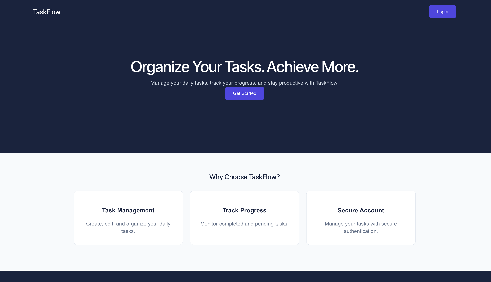
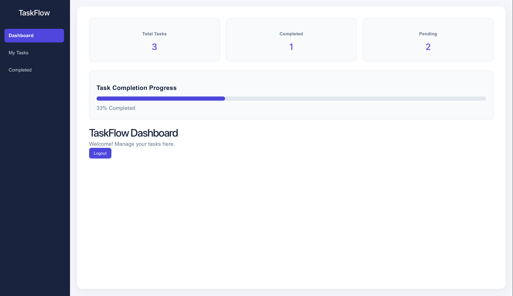
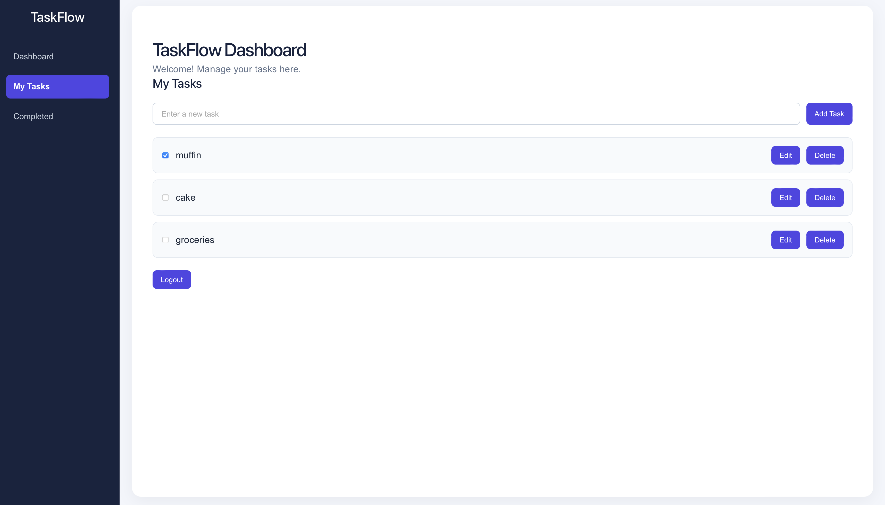

# TaskFlow — Full-Stack Task Management Application

TaskFlow is a full-stack task management application built with React, Node.js, Express.js, and PostgreSQL. It allows users to securely manage their daily tasks through a responsive and user-friendly dashboard.

## Live Demo

**Live Application:** https://taskflow-frontend-4rsz.onrender.com

## Features

- User registration and login
- Secure authentication using JWT and bcrypt
- Create, view, edit, and delete tasks
- Mark tasks as completed or pending
- Dashboard with task statistics and progress tracking
- Filter tasks by completion status
- User-specific task management
- Responsive interface for desktop and mobile

## Tech Stack

**Frontend**
- React.js
- JavaScript
- HTML5 and CSS3
- Vite

**Backend**
- Node.js
- Express.js
- RESTful APIs
- JWT authentication
- bcrypt password hashing

**Database**
- PostgreSQL
- Neon (cloud database hosting)

**Deployment and Tools**
- Render
- Git and GitHub
- Cursor

## Architecture

React Frontend → Express REST API → PostgreSQL Database

The React frontend communicates with the Express backend through HTTP requests. The backend handles authentication, processes task operations, and communicates with PostgreSQL to store and retrieve user data.

## API Endpoints

| Method | Endpoint | Description |
|---|---|---|
| POST | `/api/register` | Register a new user |
| POST | `/api/login` | Authenticate a user |
| GET | `/api/tasks` | Retrieve user tasks |
| POST | `/api/tasks` | Create a task |
| PUT | `/api/tasks/:id` | Update a task |
| DELETE | `/api/tasks/:id` | Delete a task |

## Security

- Password hashing using bcrypt
- JWT-based authentication
- Protected task endpoints
- User-specific access to tasks
- Environment variables for sensitive credentials

## Project Highlights

- Developed and deployed a full-stack application with a separate frontend, backend, and cloud-hosted database.
- Implemented RESTful APIs for task management.
- Integrated authentication and protected routes.
- Built a responsive dashboard with task statistics.
- Used GitHub for version control and Render for deployment.

## Future Improvements

- Task priorities and due dates
- Search and sorting
- Automated testing
- Improved error handling and loading states

## Author

**Halee-stack**

GitHub: https://github.com/Halee-stack

## Application Screenshots

### Homepage

### Dashboard

### Task Management
